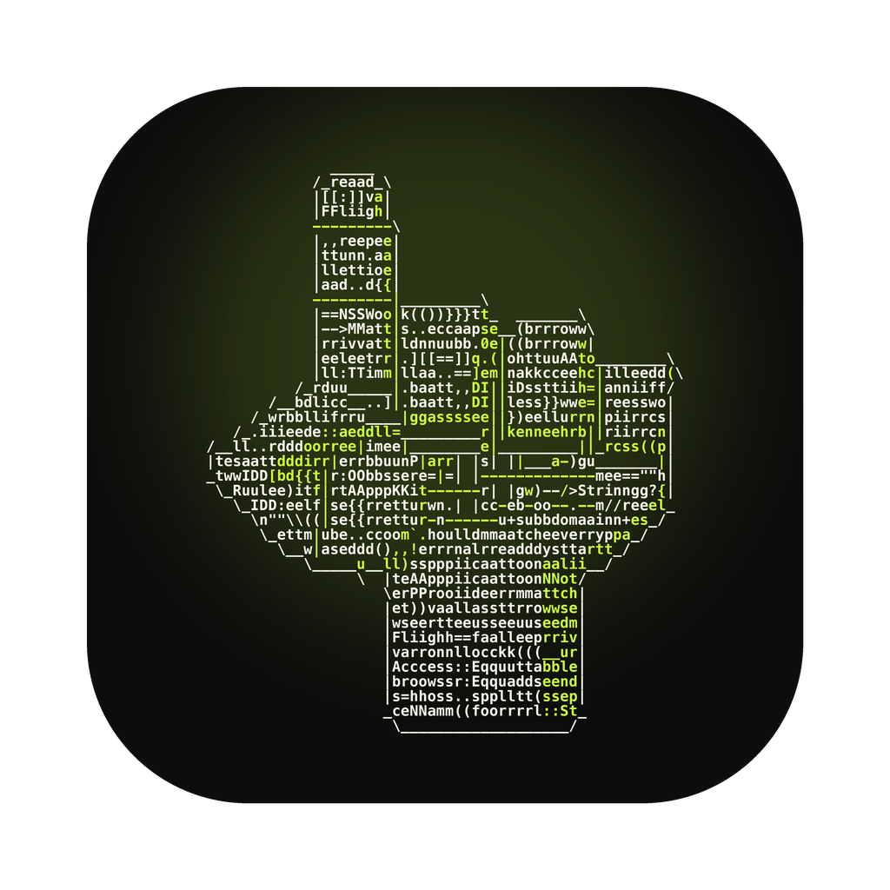
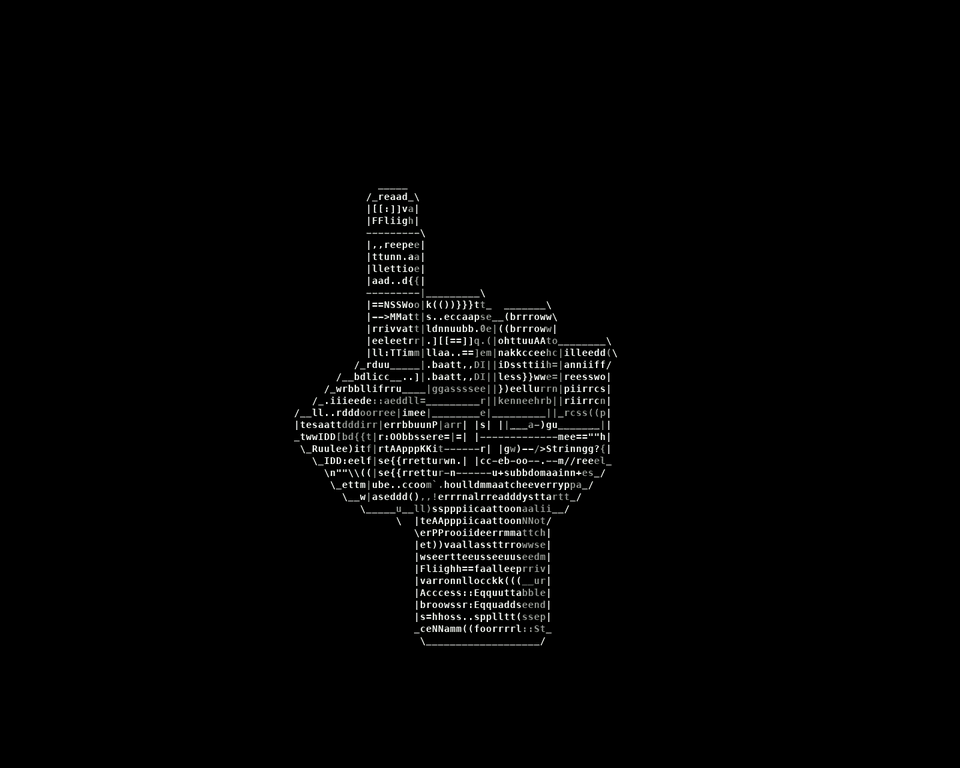

<p align="center">
  
</p>

<h1 align="center">FxxkScroll</h1>

<p align="center">
  브라우저에서 쇼츠, 릴스, 틱톡만 막습니다. 유튜브와 인스타그램의 나머지 기능은 그대로 쓸 수 있습니다.<br>
  macOS 메뉴 막대 앱입니다.
</p>

<p align="center">
  <a href="https://github.com/Kyun92/fxxkscroll/releases/latest"><b>내려받기</b></a>
  &nbsp;|&nbsp;
  <a href="README.md">English</a>
</p>

<p align="center">
  
</p>

## 만든 이유

강의 하나 보려고 유튜브를 열었는데, 40분 뒤에도 쇼츠를 넘기고 있습니다.

FxxkScroll은 유튜브와 인스타그램을 통째로 막지 않습니다. 짧은 영상 페이지만 막아서 검색, 긴 영상, 메시지는 그대로 쓸 수 있습니다. 《아주 작은 습관의 힘》에 나오는 규칙대로 나쁜 습관은 시작하기 어렵게 만듭니다.

- **바로 막습니다.** 쇼츠, 릴스, 틱톡 페이지를 열면 그 탭이 차단 화면으로 바뀝니다.
- **끄기 어렵습니다.** 차단을 끄려면 30초를 기다려야 합니다. 그사이 다른 창으로 넘어가면 처음부터 다시 셉니다.
- **횟수를 보여 줍니다.** 오늘 몇 번 막았는지 메뉴에 나옵니다.

## 막는 주소

| 패턴 | 막는 곳 |
|---|---|
| `youtube.com/shorts/*` | 유튜브 쇼츠 |
| `instagram.com/reels/*` | 인스타그램 릴스 탭 |
| `instagram.com/reel/*` | 릴스 영상 하나하나 |
| `tiktok.com` | 틱톡 전체 |

메뉴 막대에서 **차단 목록 > 현재 탭 추가** 또는 **직접 추가…**로 주소를 더할 수 있습니다. 목록에서 ⌥ 키를 누르고 있으면 삭제 메뉴로 바뀝니다.

패턴 쓰는 법은 이렇습니다.
- `*`는 아무 글자나 대신합니다. `facebook.com/reel/*`은 페이스북 릴스를 모두 막습니다.
- 경로 없이 사이트 주소만 쓰면 사이트 전체를 막습니다. `x.com`은 X 전체를 막습니다.
- 하위 도메인도 같이 막습니다. `youtube.com/shorts/*`는 `m.youtube.com/shorts/...`도 막습니다.

## 설치

macOS 13 Ventura 이상에서 돌아갑니다. Apple 실리콘 맥과 인텔 맥 모두 됩니다.

1. [Releases](https://github.com/Kyun92/fxxkscroll/releases/latest)에서 `FxxkScroll-x.y.z.zip`을 내려받습니다.
2. 압축을 풀고 `FxxkScroll.app`을 **응용 프로그램** 폴더로 옮깁니다.
3. 앱을 엽니다. 처음에는 macOS가 실행을 막습니다(아래 참고).

### "FxxkScroll을(를) 열 수 없습니다"가 나올 때

FxxkScroll은 유료 Apple 개발자 인증서로 서명하지 않아서 처음 실행할 때 macOS가 막습니다. 둘 중 하나로 풀면 됩니다.

- **시스템 설정 > 개인정보 보호 및 보안**을 열고 아래로 내려 FxxkScroll 옆의 **그래도 열기**를 누릅니다.
- 터미널에서 아래 명령을 실행합니다.
  ```sh
  xattr -dr com.apple.quarantine /Applications/FxxkScroll.app
  ```

새 버전마다 한 번만 하면 됩니다. 앱이 무슨 일을 하는지 확인하거나 직접 빌드하고 싶다면 이 저장소에 전체 소스가 있습니다.

### 브라우저 권한

FxxkScroll은 브라우저 탭 주소를 읽어야 합니다. 브라우저마다 처음 한 번 macOS가 이렇게 묻습니다.

> "FxxkScroll"이(가) "Google Chrome"을(를) 제어하려고 합니다.

**확인**을 누릅니다. **허용 안 함**을 눌렀다면 메뉴에 "권한 필요"가 나옵니다. **시스템 설정 > 개인정보 보호 및 보안 > 자동화 > FxxkScroll**에서 다시 켜면 됩니다.

새 버전으로 바꾸면 macOS가 권한을 다시 물을 수 있습니다.

## 브라우저

| 브라우저 | 상태 |
|---|---|
| Google Chrome | 확인함 |
| Safari | 지원 |
| Arc, Microsoft Edge, Brave, Vivaldi, Chromium | 지원, 아직 확인 못 함 |

Firefox는 지원하지 않습니다. 다른 앱이 탭 주소를 읽지 못하게 막혀 있습니다.

## 개인정보

- FxxkScroll은 열린 탭의 주소를 1초에 한 번쯤 읽습니다. 모든 처리는 내 맥 안에서 끝납니다.
- 인터넷으로 아무것도 보내지 않습니다. 수집하는 정보도 없습니다.
- 차단 목록은 `~/Library/Application Support/FxxkScroll/rules.json`에 저장됩니다.

## 동작 방식

HTTPS는 페이지 경로를 암호화합니다. 그래서 DNS나 방화벽으로 막으면 youtube.com 전체를 막을 수밖에 없습니다. FxxkScroll은 켜져 있는 브라우저에 AppleScript로 탭 주소를 물어봅니다. 주소가 차단 목록과 맞으면 그 탭에 앱 안의 차단 화면을 띄웁니다.

## 소스에서 빌드

```sh
brew install xcodegen
git clone https://github.com/Kyun92/fxxkscroll.git
cd fxxkscroll
xcodegen generate
open FxxkScroll.xcodeproj
```

테스트는 `xcodebuild -project FxxkScroll.xcodeproj -scheme FxxkScroll -destination 'platform=macOS' test`로 돌립니다.

디버그 빌드를 다시 해도 브라우저 권한이 유지되게 하려면 `Config/Local.xcconfig.example`을 `Config/Local.xcconfig`로 복사하고 내 팀 ID를 넣습니다.

`scripts/release.sh`는 배포용 zip을 만듭니다.

## 라이선스

[MIT](LICENSE)
