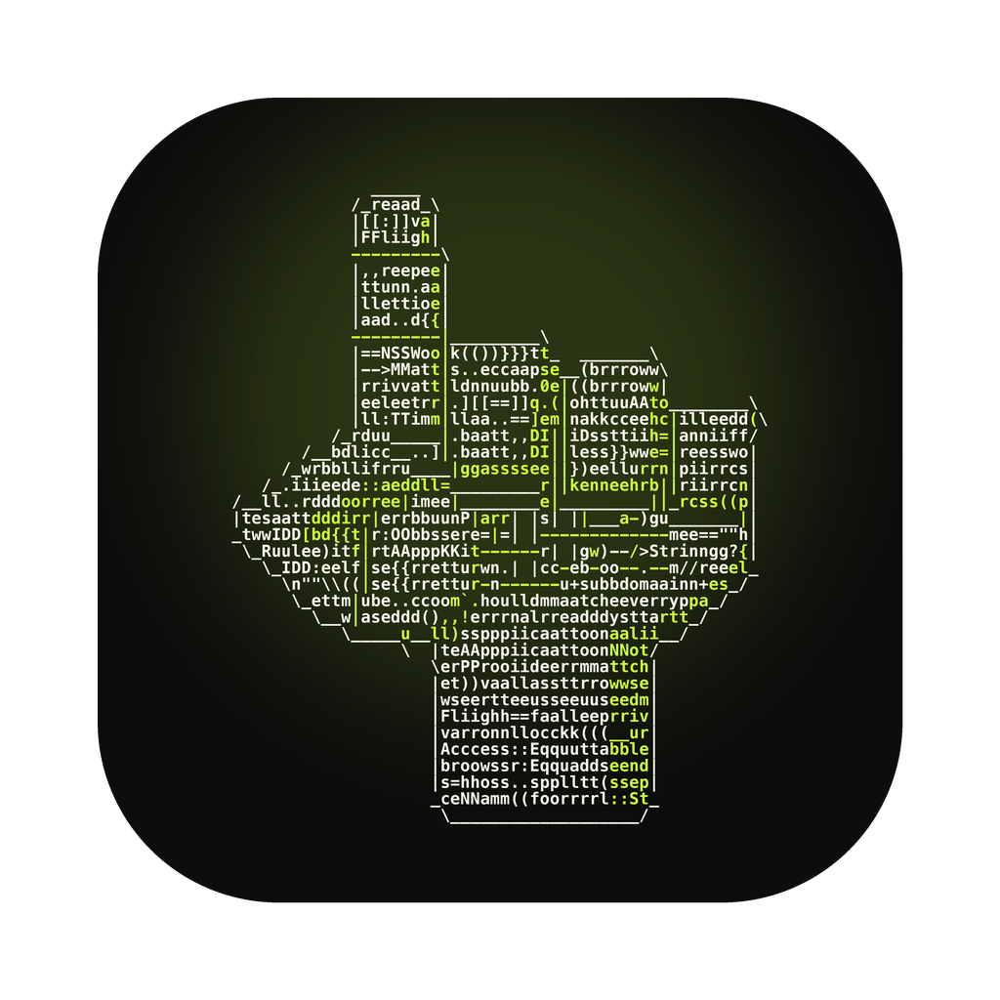
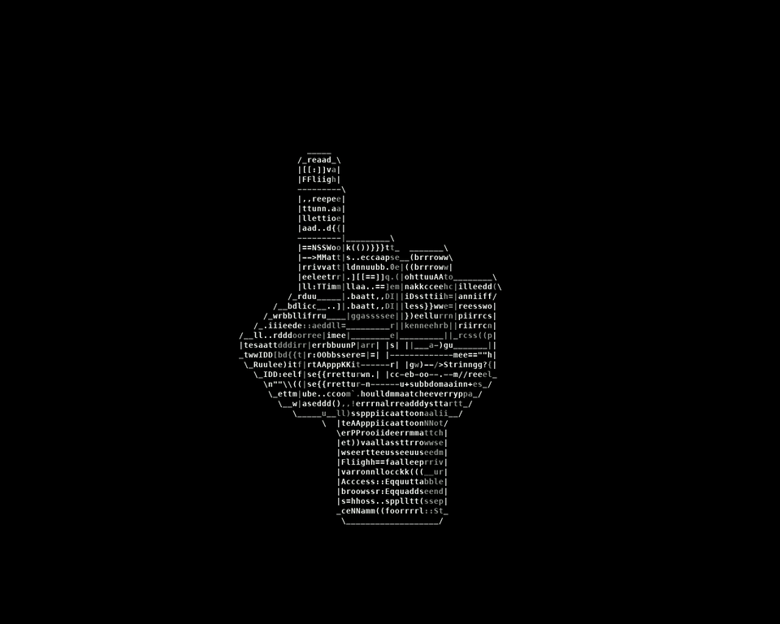

<p align="center">
  
</p>

<h1 align="center">FxxkScroll</h1>

<p align="center">
  Blocks Shorts, Reels and TikTok in your browser. The rest of YouTube and Instagram keeps working.<br>
  A tiny macOS menu bar app.
</p>

<p align="center">
  <a href="https://github.com/Kyun92/fxxkscroll/releases/latest"><b>Download</b></a>
  &nbsp;|&nbsp;
  <a href="README.ko.md">한국어</a>
</p>

<p align="center">
  
</p>

## Why

You open YouTube to watch one tutorial. Forty minutes later you are still swiping Shorts.

FxxkScroll does not block YouTube or Instagram. It blocks only the short-form pages, so you can still search, watch long videos and check messages. It follows the habit rule from *Atomic Habits*: make the bad habit hard to start.

- **Blocked right away.** Open a Shorts, Reels or TikTok page and the tab is sent to a block page.
- **Hard to turn off.** Turning blocking off takes a 30 second countdown. Switch to another window and it starts over.
- **You see the count.** The menu shows how many times it blocked you today.

## What it blocks

| Pattern | Blocks |
|---|---|
| `youtube.com/shorts/*` | YouTube Shorts |
| `instagram.com/reels/*` | Instagram Reels tab |
| `instagram.com/reel/*` | Single Reels |
| `tiktok.com` | All of TikTok |

Add your own from the menu bar: **Block List > Add Current Tab** or **Add Manually…**. Hold ⌥ in the list to delete a pattern.

Pattern rules:
- `*` matches anything. `facebook.com/reel/*` blocks every Facebook Reel.
- A pattern without a path blocks the whole site. `x.com` blocks all of X.
- Subdomains are included. `youtube.com/shorts/*` also blocks `m.youtube.com/shorts/...`.

## Install

Requires macOS 13 Ventura or later. Works on Apple silicon and Intel.

1. Download `FxxkScroll-x.y.z.zip` from [Releases](https://github.com/Kyun92/fxxkscroll/releases/latest).
2. Unzip it and move `FxxkScroll.app` to **Applications**.
3. Open it. macOS will block it the first time (see below).

### "FxxkScroll cannot be opened"

FxxkScroll is not signed with a paid Apple Developer ID, so macOS stops it on first launch. Either:

- Open **System Settings > Privacy & Security**, scroll down and click **Open Anyway** next to FxxkScroll. Or
- Run this in Terminal:
  ```sh
  xattr -dr com.apple.quarantine /Applications/FxxkScroll.app
  ```

You only need to do this once per version. The full source is in this repository if you want to check what it does or build it yourself.

### Browser permission

FxxkScroll needs to read the address of your browser tabs. The first time it sees each browser, macOS asks:

> "FxxkScroll" wants access to control "Google Chrome".

Click **OK**. If you clicked **Don't Allow**, the menu shows "No permission". Turn it on again in **System Settings > Privacy & Security > Automation > FxxkScroll**.

After updating to a new version, macOS may ask again.

## Browsers

| Browser | Status |
|---|---|
| Google Chrome | Tested |
| Safari | Supported |
| Arc, Microsoft Edge, Brave, Vivaldi, Chromium | Supported, not tested yet |

Firefox is not supported. It does not let other apps read its tab addresses.

## Privacy

- FxxkScroll reads the address of the open tabs about once a second, on your Mac only.
- It makes no network requests. Nothing is collected or sent.
- Your block list is saved in `~/Library/Application Support/FxxkScroll/rules.json`.

## How it works

HTTPS hides the page path from the network, so a DNS or firewall blocker can only block all of youtube.com. FxxkScroll asks running browsers for their tab addresses with AppleScript. When an address matches the block list, it loads a local block page in that tab.

## Build from source

```sh
brew install xcodegen
git clone https://github.com/Kyun92/fxxkscroll.git
cd fxxkscroll
xcodegen generate
open FxxkScroll.xcodeproj
```

Run the tests with `xcodebuild -project FxxkScroll.xcodeproj -scheme FxxkScroll -destination 'platform=macOS' test`.

To keep the browser permission between debug builds, copy `Config/Local.xcconfig.example` to `Config/Local.xcconfig` and put in your own team ID.

`scripts/release.sh` builds the universal release zip.

## License

[MIT](LICENSE)
